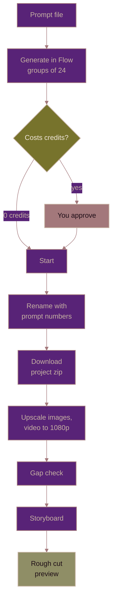

# Google Flow Video and Image Generator


> Hand Claude a prompt file and get back numbered, 4K-ready images and 1080p video from Google Flow, with a storyboard and a rough cut, and credits that are never spent behind your back.


> **Heads up:** Flow has no official API. This skill drives the Flow web app in your own logged-in Chrome session through browser automation. Check Google's terms of use and accept the account risk before using it.

**Contents:** [Why](#why-this-exists) · [Prompt file to rough cut](#prompt-file-to-rough-cut) · [What makes it different](#what-makes-it-different) · [4K without the credit bill](#4k-without-the-credit-bill) · [How it works](#how-it-works) · [The prompt file](#the-prompt-file) · [Credit safety](#credit-safety) · [Quality targets](#quality-targets) · [Guardrails](#guardrails) · [Requirements](#requirements) · [Install](#install) · [Example prompts](#example-prompts) · [Example conversation](#example-conversation) · [FAQ](#faq) · [Limitations](#limitations) · [Credits](#credits) · [License](#license)

## What's new in v1.1.0

- **Durations and credits (a snapshot):** the models Flow offered (Omni 1.2 Flash 3 to 15 seconds, Veo 3.1 at 4, 6 or 8 seconds), a credit table for Omni 1.2 Flash at 720p and the fixed Veo prices, with the rule that you still read the price Flow displays.
- **Lessons from working in Flow:** where splatter and confetti come from, why colors come out darker, how to fix a video, the chat panel, batch generation with a reference in every message, matching images to prompt numbers, and browser traps. They are in [SKILL.md](SKILL.md).

## Why this exists

Producing hundreds of scenes by hand in Flow is slow and easy to get wrong. Numbering gets lost, character descriptions are forgotten between batches, downloads arrive in the wrong size, and credits get spent by accident. Most people end up babysitting a browser tab for hours.

This skill gives Claude one strict, repeatable routine for the whole line, so you hand over a prompt file and review the result instead of clicking through it.

| | By hand | **With this skill** |
|---|---|---|
| Submitting prompts | Paste, wait, repeat for every scene | Groups of 24, with your shared vocabulary block pasted before every group |
| File names | Whatever Flow gives you | Every item renamed with its prompt number (001, 002, ...) |
| Credits | Easy to spend by accident | Price quoted first, nothing spent without your yes, "always approve" never chosen |
| Image size | The size Flow hands you | Upscaled to 4K outside Flow |
| Missing items | Found late, by eye | Counted and reported by number |
| Review | Scroll through hundreds of files | Labeled storyboard sheets, then a rough cut |

## Prompt file to rough cut

1. **Write the script once.** Your prompt file carries labels, timings and a shared world vocabulary (characters, symbols, style).
2. **Let Claude run the line.** It generates in Flow, asks before any credit is spent, numbers every output and downloads the project.
3. **Check and review.** A gap check, storyboard sheets and a HyperFrames rough cut show you what you have before you edit.

## 4K without the credit bill

Flow's project download gives images at 1K and video at 720p, and its own bulk 4K download is lower quality. This skill closes that gap on purpose:

- **Images** are upscaled to **4K outside Flow** (for example Real-ESRGAN on a free cloud GPU notebook), keeping the prompt number in every file name.
- **Video** is brought to **1080p** with `ffmpeg`. It is never upscaled to 4K, because that is very expensive in credits.
- The result: sharp 4K stills and clean 1080p clips, with the heavy conversion done outside Flow.

## What makes it different

These are methods the author found by trial and error, and they are the heart of the skill:

- **Groups of 24 with the vocabulary block repeated.** Flow forgets the world vocabulary between submissions, so it is pasted before every group of 24 prompts.
- **Rename by prompt number.** Every output gets its prompt number, so scenes, narration and files stay in sync.
- **Project zip, then upscale outside Flow.** The zip is the reliable route; images go to 4K on a free cloud GPU, video to 1080p with `ffmpeg`. Video is never upscaled to 4K.
- **Credit gate.** The displayed price is quoted, you say yes, and "always approve" is never chosen.
- **One project per video.** Heavy projects freeze the tab, so each video gets a fresh one.
- **Real Chrome, not a test browser.** A separate automated browser never finished Flow's upscale step; the real Chrome profile worked.

## How it works



| # | Step | What happens |
|---|---|---|
| 1 | Generate | A new Flow project per video. The shared vocabulary block plus one group of 24 prompts is pasted for each submission, and the credit cost is shown to you first. |
| 2 | Rename | Every item is renamed with its prompt number (001, 002, ...), 24 at a time. |
| 3 | Download | Main route: the project zip. Backup route: an optional download extension. Images are upscaled to 4K outside Flow, videos are brought to 1080p with `ffmpeg`. |
| 4 | Check for gaps | Numbered files are counted and missing numbers reported. |
| 5 | Storyboard | Labeled 640 px previews in sheets of 24; missing items show as gray boxes. |
| 6 | Rough cut | A HyperFrames preview with durations from your prompt labels, light previews, narration cut to the same time ranges, gentle Ken Burns motion and short fades. |

## The prompt file

Each prompt starts with a label, followed by one paragraph:

```text
001 | IMAGE | 00:00.0-00:06.0 | 6.0 s
<one paragraph describing the scene>
```

- Prompts come in groups of 24, with blank lines between groups.
- A trailing `CHECK` line (a closing note) is not a prompt.
- A shared "world vocabulary" block at the top of the file (the characters, symbols and visual style used by every scene) is pasted before **every** group, because Flow does not remember it between submissions.
- For the rough cut you also need the narration audio and, optionally, its subtitles.

## Credit safety

| Situation | What the skill does |
|---|---|
| An action costs credits | Quotes the price Flow displays, asks "Approve?", and presses Approve only after your yes |
| An action costs 0 credits | Starts without asking |
| "Always approve in project" is offered | Never chooses it |
| Prices change with model or resolution | Always reads the displayed price; remembered numbers are used only as labeled snapshots or estimates |

## Quality targets

- **Images:** 4K.
- **Video:** 1080p. Video is never upscaled to 4K, because it is very expensive in credits.
- Flow's own bulk 4K download is not used; its quality is lower.

## Guardrails

- One Flow project per video; old or heavy projects freeze the browser tab.
- Every output is numbered after generating; syncing with the script depends on it.
- No deleting or moving files without asking (browser `(1)` duplicates are listed first).
- No parallel downloads; Flow shows reCAPTCHA and "one upscale at a time" warnings.
- Work happens one step at a time, at human speed.

## Requirements

Everything below is checked on the first run, and the skill offers to install what is missing (it always asks first).

| Needed | For | How it is set up |
|---|---|---|
| Claude Code with browser automation (for example Claude in Chrome) | Driving Flow | Install the extension and connect it |
| A Google Flow account, signed in through Chrome | Generation | You sign in yourself |
| `ffmpeg` | Previews and 1080p video | `winget install Gyan.FFmpeg` (Windows), `brew install ffmpeg` (macOS) |
| A free cloud GPU notebook with Real-ESRGAN (recommended) | Upscaling images to 4K | Google Colab with an L4 GPU: upload the 1K images, run the 4x upscale, download. About 4 s per image in the author's tests. |
| Optional: Node.js and HyperFrames | The rough-cut preview | Node.js, then `npx hyperframes` |
| Optional: a Chrome download extension | The backup download route | Install it in Chrome |

## Install

```bash
git clone https://github.com/jenny-gecglr/google-flow-video-image-generator.git ~/.claude/skills/google-flow-video-image-generator
```

Or download the folder and place it at `~/.claude/skills/google-flow-video-image-generator`.

## Example prompts

- "Generate this prompt file in Flow."
- "Make the storyboard for the scenes we just generated."
- "Generate this one image in Flow."

## Example conversation

An illustration of the flow (the numbers are made up; real prices are whatever Flow displays):

```text
You:    Generate this prompt file in Flow.
Claude: I created a new Flow project and pasted the vocabulary block with the
        first group of 24 prompts (10 videos, 14 images). Flow shows a cost of
        180 credits. Approve?
You:    Yes.
Claude: Approved with the plain Approve button. Generation is running. When it
        finishes I will rename all 24 items 001 to 024 and then continue with
        the next group.
You:    Make the storyboard when everything is downloaded.
Claude: 48 of 48 files found, no missing numbers. Here are the two sheets of
        24 previews.
```

## FAQ

**Will it spend my credits automatically?** No. Anything that costs credits waits for your explicit yes.

**Why groups of 24?** The Flow agent handles at most 24 items per run, and its bottom strip shows only that group.

**Why not upscale video to 4K?** It is very expensive in credits. Video stays at 1080p.

**Why upscale images outside Flow?** Flow's own bulk 4K download is lower quality, and local upscaling on a weak laptop gave poor results. A free cloud GPU notebook worked.

**Is this an official Google tool?** No. It automates the Flow web app and is not affiliated with Google.

## Limitations

- Browser automation depends on Flow's interface; a redesign can break steps.
- It is deliberately slow and sequential, not a bulk-generation tool.
- Browser tabs freeze with lots of media. If screenshots time out, the skill reads the page text or uses JavaScript, then reloads.

## Credits

The visual identity of this repository (its color palette and art direction) is the author's own. The banner illustration was generated with Google Flow (Nano Banana) from original prompts, and the lettering was added afterwards. The title is set in Cinzel Decorative, the script line in Pinyon Script and the subtitle in Cormorant Garamond, all under the SIL Open Font License.

## License

MIT. See [LICENSE](LICENSE).
