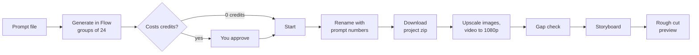

# Google Flow Video Generator

> Run a full AI image and video production line in Google Flow from a prompt file: generate, number, download, check for gaps, storyboard and rough-cut, with credits that are never spent behind your back.


> **Heads up:** Flow has no official API. This skill drives the Flow web app in your own logged-in Chrome session through browser automation. Check Google's terms of use and accept the account risk before using it.

**Contents:** [Why](#why-this-exists) · [How it works](#how-it-works) · [The prompt file](#the-prompt-file) · [Credit safety](#credit-safety) · [Quality targets](#quality-targets) · [Guardrails](#guardrails) · [Requirements](#requirements) · [Install](#install) · [Example prompts](#example-prompts) · [FAQ](#faq) · [Limitations](#limitations) · [License](#license)

## Why this exists

Producing hundreds of scenes by hand in Flow is slow and easy to get wrong: numbering gets lost, character descriptions are forgotten between batches, and credits are spent by accident. This skill gives Claude one strict, repeatable routine for the whole line, from prompt file to rough cut.

## How it works



| # | Step | What happens |
|---|---|---|
| 1 | Generate | A new Flow project per video. The shared vocabulary block plus one group of 24 prompts is pasted for each submission, and the credit cost is shown to you first. |
| 2 | Rename | Every item is renamed with its prompt number (001, 002, ...), 24 at a time. |
| 3 | Download | Main route: the project zip. Backup route: an optional download extension. Images are upscaled to 4K outside Flow, videos are brought to 1080p with `ffmpeg`. |
| 4 | Check for gaps | Numbered files are counted and missing numbers reported. |
| 5 | Storyboard | Labeled 640 px previews in sheets of 24; missing items show as gray boxes. |
| 6 | Rough cut | A HyperFrames preview with durations from your prompt labels, light previews, narration cut to the same time ranges, gentle Ken Burns motion and short fades. |

## The prompt file

Each prompt starts with a label, followed by one paragraph:

```text
001 | IMAGE | 00:00.0-00:06.0 | 6.0 s
<one paragraph describing the scene>
```

- Prompts come in groups of 24, with blank lines between groups.
- A trailing `CHECK` line (a closing note) is not a prompt.
- A shared "world vocabulary" block at the top of the file (the characters, symbols and visual style used by every scene) is pasted before **every** group, because Flow does not remember it between submissions.
- For the rough cut you also need the narration audio and, optionally, its subtitles.

## Credit safety

| Situation | What the skill does |
|---|---|
| An action costs credits | Quotes the price Flow displays, asks "Approve?", and presses Approve only after your yes |
| An action costs 0 credits | Starts without asking |
| "Always approve in project" is offered | Never chooses it |
| Prices change with model or resolution | Always reads the displayed price; never relies on remembered numbers |

## Quality targets

- **Images:** 4K.
- **Video:** 1080p. Video is never upscaled to 4K, because it is very expensive in credits.
- Flow's own bulk 4K download is not used; its quality is lower.

## Guardrails

- One Flow project per video; old or heavy projects freeze the browser tab.
- Every output is numbered after generating; syncing with the script depends on it.
- No deleting or moving files without asking (browser `(1)` duplicates are listed first).
- No parallel downloads; Flow shows reCAPTCHA and "one upscale at a time" warnings.
- Work happens one step at a time, at human speed.

## Requirements

| Needed | For |
|---|---|
| Claude Code with browser automation (for example Claude in Chrome) | Driving Flow |
| A Google Flow account, signed in through Chrome | Generation |
| `ffmpeg` | Previews and 1080p video |
| Recommended: a free cloud GPU notebook with Real-ESRGAN (or an equivalent upscaler) | Upscaling images to 4K |
| Optional: HyperFrames | The rough-cut preview |
| Optional: a Chrome download extension | The backup download route |

## Install

```bash
git clone https://github.com/jenny-gecglr/google-flow-video-generator.git ~/.claude/skills/google-flow-video-generator
```

Or download the folder and place it at `~/.claude/skills/google-flow-video-generator`.

## Example prompts

- "Generate this prompt file in Flow."
- "Make the storyboard for the scenes we just generated."
- "Generate this one image in Flow."

## FAQ

**Will it spend my credits automatically?** No. Anything that costs credits waits for your explicit yes.

**Why groups of 24?** The Flow agent handles at most 24 items per run, and its bottom strip shows only that group.

**Why not upscale video to 4K?** It is very expensive in credits. Video stays at 1080p.

**Why upscale images outside Flow?** Flow's own bulk 4K download is lower quality, and local upscaling on a weak laptop gave poor results. A free cloud GPU notebook worked.

**Is this an official Google tool?** No. It automates the Flow web app and is not affiliated with Google.

## Limitations

- Browser automation depends on Flow's interface; a redesign can break steps.
- It is deliberately slow and sequential, not a bulk-generation tool.
- Browser tabs freeze with lots of media. If screenshots time out, the skill reads the page text or uses JavaScript, then reloads.

## License

MIT. See [LICENSE](LICENSE).
